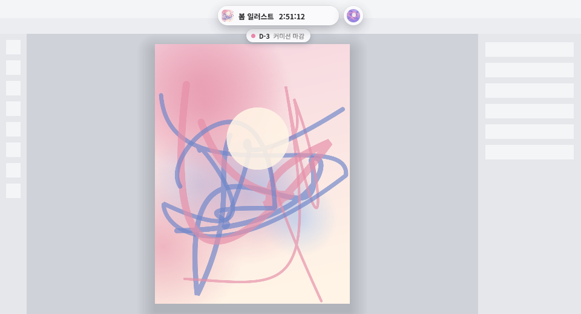
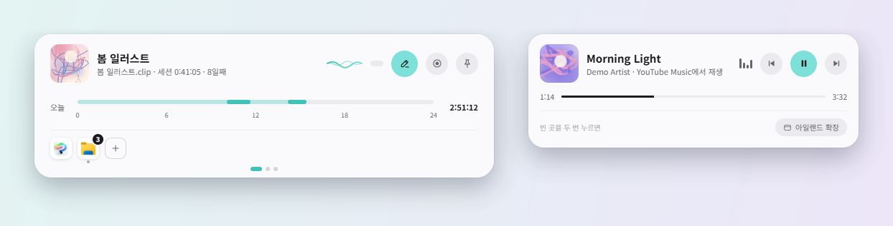
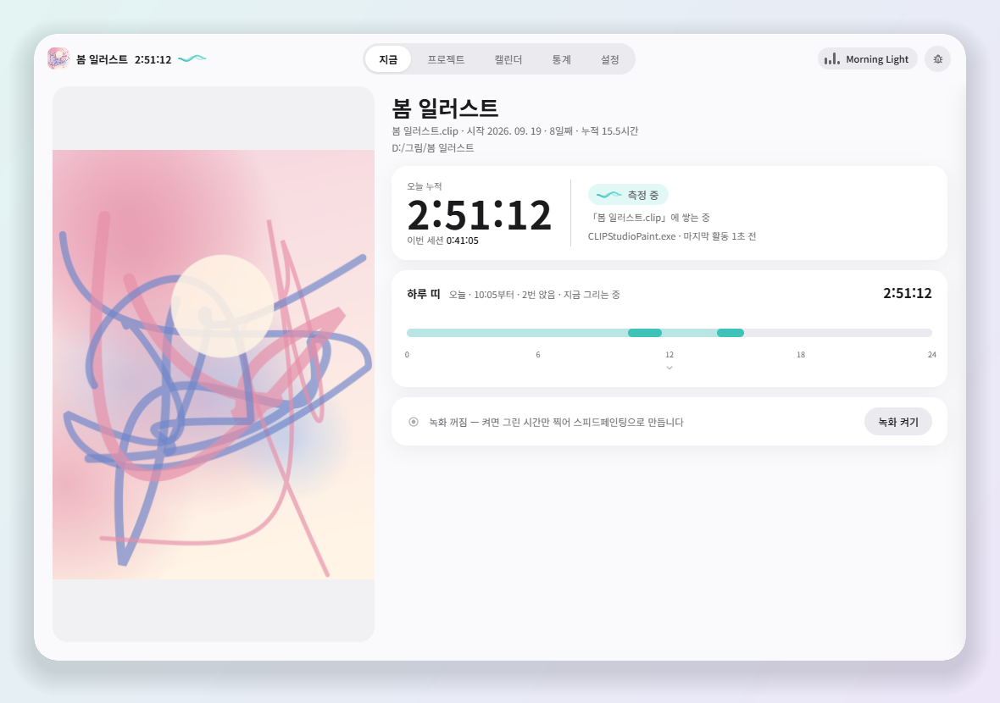
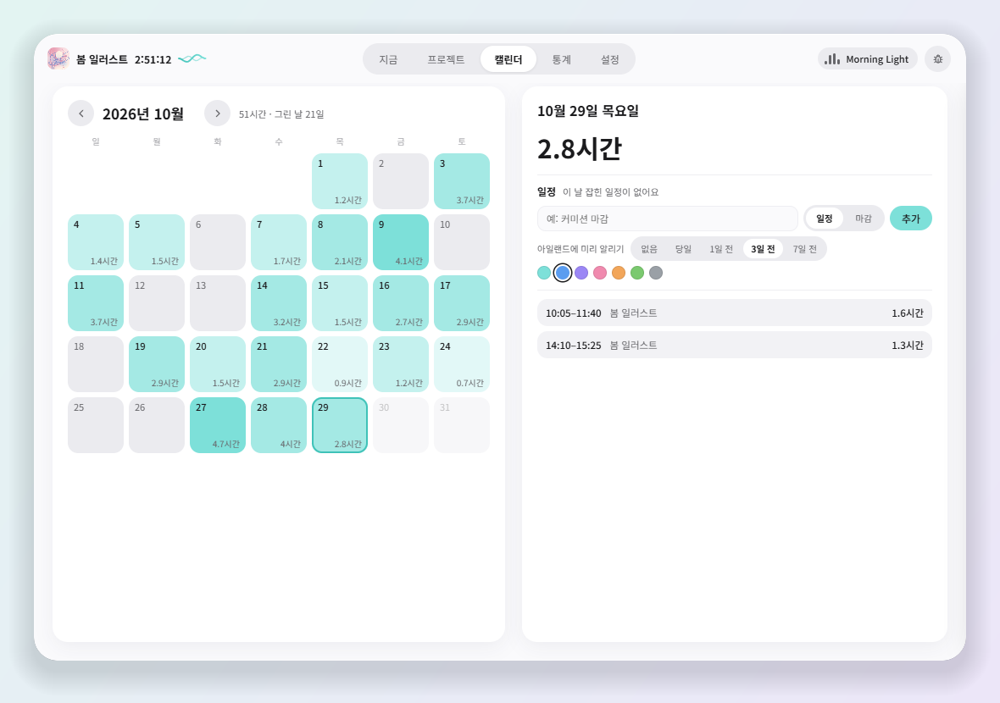
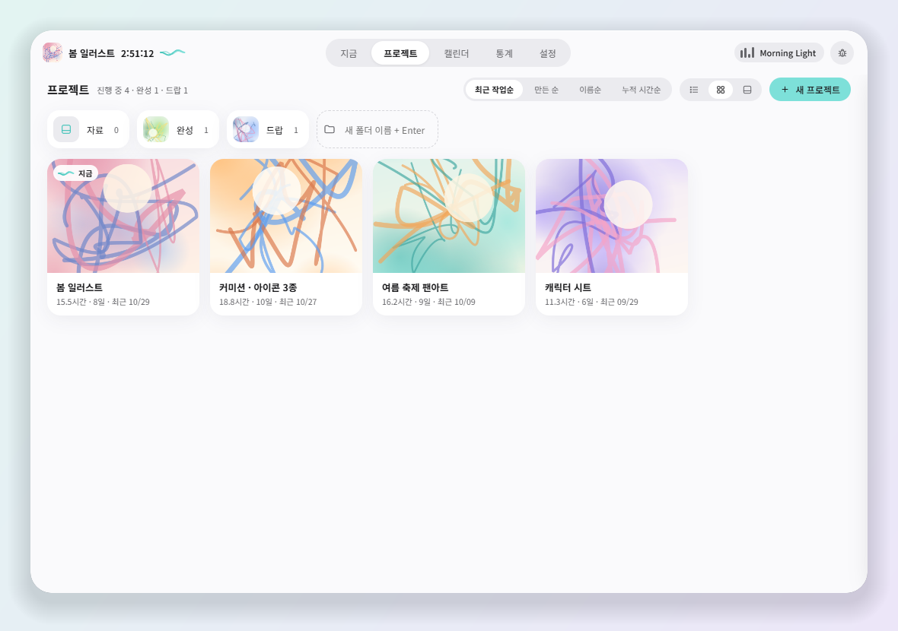
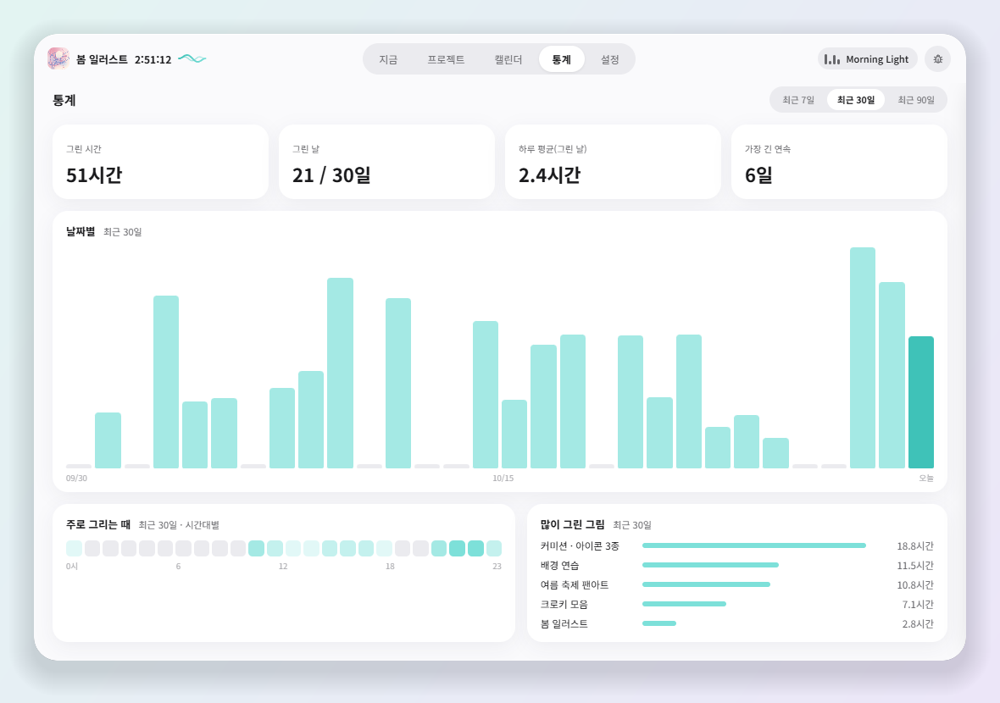

# 아트 워크 아일랜드

**그림 그린 시간을 알아서 재는, 화면 위 알약 하나.**
그림 프로그램을 켜고 그리기 시작하면 시간이 쌓이고, 화면 위 가운데의 작은 알약에 오늘 시간과 물결이 흐릅니다.
마우스를 올리면 그 자리에서 펼쳐지고, 크게 보기에서 프로젝트 · 캘린더 · 통계를 봅니다.





 
 

<sub>화면 속 그림 · 이름 · 기록은 모두 예시입니다.</sub>

[아트 워크 트래커](https://github.com/4ya-u/art-work-tracker)를 알약 하나로 다시 만든 새 앱입니다.

---

## 무엇을 해 주나요

**시간을 대신 잽니다.**
CLIP STUDIO PAINT나 Photoshop 창이 앞에 있고 손이 움직이는 동안만 시간이 갑니다.
자리를 비우면(기본 5분) 알아서 멈추고, 돌아와 다시 그리면 알아서 이어집니다.

**어느 그림인지 알아봅니다.**
열린 그림을 프로젝트에 붙여 둡니다. 어느 그림인지 모르는 시간은 따로 담아 두었다가,
저장해서 어떤 프로젝트 폴더의 파일이 바뀌면 그쪽으로 옮겨 줍니다.

**알약이 지금을 보여 줍니다.**
그리는 동안 알약에 오늘 시간과 물결이 흐르고, 그리기와 쉬기가 바뀌면 물결로 알려 줍니다.
그림도 음악도 없을 때의 모양은 고를 수 있습니다 — 숨김 · 손잡이 · 오늘 기록 · 이어 그리기.

**지금 듣는 음악도 같이.**
유튜브 · 유튜브 뮤직 · 스포티파이처럼 미디어 키로 조절되는 앱의 곡과 앨범 그림을 보여 주고,
곡 넘기기 · 멈춤도 알약에서 합니다.

**바로 열기.**
시작 판에서는 자주 쓰는 앱을, 그리는 중에는 그 그림의 자료 폴더 그림을 바로 엽니다.

**방해하지 않습니다.**
게임 · 영상을 전체 화면으로 보면 위로 숨고, 인터넷 브라우저를 쓰는 동안에는 탭을 가리지 않게 비켜 줍니다.
그림 창을 빼앗지 않아서 알약을 눌러도 그리던 흐름이 끊기지 않습니다.

**스피드페인팅 녹화** (설정에서 켬)
시간을 재는 동안 그림 프로그램 창만 찍고, 손을 멈추면 같이 멈춥니다.
처음 켤 때 녹화 도구(ffmpeg, 약 40MB)를 한 번 내려받습니다.

---

## 설치

1. [최신 릴리스](https://github.com/4ya-u/art-work-island/releases/latest)에서 `ArtWorkIsland-v○.○.○.zip`을 받습니다
2. 원하는 폴더에 풀고 `ArtWorkIsland.exe`를 실행합니다

설치 과정이 없습니다. 레지스트리도 'Windows 켤 때 같이 실행'을 켰을 때만 건드립니다.
지울 때는 폴더째 지우면 됩니다.

**필요한 것**: Windows 10 / 11 (64비트).

**업데이트**: 크게 보기 > 설정 > 업데이트 에서 확인하고 받으면, 앱이 스스로 껐다 켜지며 적용됩니다.
새 zip을 폴더에 덮어써도 됩니다 — `data` 폴더는 zip에 들어 있지 않아 기록이 남습니다.

---

## 내 기록은 어디에 있나요

앱 폴더 안의 `data` 폴더 하나입니다.

```
data\tracker.db      작업 기록 · 프로젝트
data\settings.json   설정
data\thumbs\         썸네일 캐시 (지워도 다시 만들어집니다)
data\logs\app.log    오류 기록
```

백업은 `data\tracker.db` 한 파일만 복사해 두면 됩니다.

인터넷은 업데이트를 확인할 때, 녹화 도구를 처음 받을 때, 그리고 **직접 보낸 버그 신고 · 건의**에만 씁니다.
버그 신고에 진단 정보(버전 · 설정 · 최근 오류 기록)를 붙일지는 보내기 전에 내용을 보고 고를 수 있습니다.

---

## 버그 신고 · 건의

크게 보기 > 설정 > **의견**에서 앱 안에서 바로 보낼 수 있습니다(크게 보기 오른쪽 위 버그 버튼, 트레이 메뉴로도 열립니다).

---

## 버전 읽는 법

[유의적 버전(SemVer)](https://semver.org/lang/ko/)을 따릅니다.

```
1 . 4 . 2
│   │   └── 버그만 고쳤을 때
│   └────── 기능을 더하거나 고쳤을 때 (기록과 설정은 그대로)
└────────── 크게 바뀌었을 때
```

`0`으로 시작하는 버전(`0.x.y`)은 **공개 시험판**입니다 — 쓰는 법이 아직 바뀔 수 있습니다.

---

## 만든 사람에게

취미로 그림을 그리면서 쓰려고 만든 개인 프로젝트입니다. Windows에서만 동작합니다
(그림 프로그램 창을 알아보는 부분과 화면 녹화가 Windows 전용입니다).
